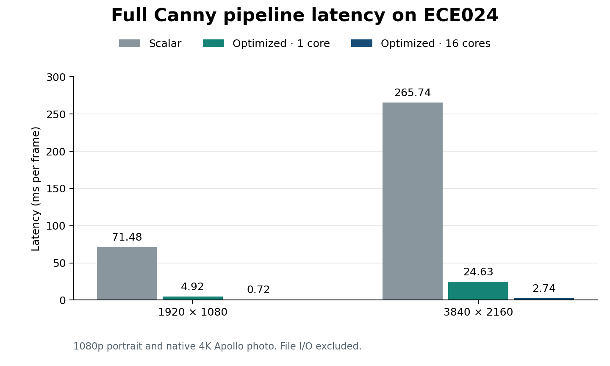

# Canny edge detection on ECE024

The optimized Canny pipeline reads an 8-bit grayscale image and returns an edge map. OpenMP workers run Gaussian blur, Sobel, non-maximum suppression (NMS) and double thresholding on local tiles. Hysteresis connects edges across the resulting labels.

## Build and run

On ECE024, from this directory, run the following commands with GCC, GNU Make, OpenMP and binutils installed.

```sh
make fusion FUSION_IMAGE=noise        # generated image, scalar check and timing
make fusion                          # uses canny-fusion-inputs/photo-1920.raw
make pipeline-asm                    # refresh assembly/ from the final executable
```

For your own image set FUSION_IMAGE, FUSION_WIDTH and FUSION_HEIGHT. Use headerless grayscale with one byte per pixel in row-major order. The driver reports filter, tracking and total milliseconds and prints **exact** when both labels and edges match the scalar reference.

## Follow a pixel through the source

[Browse the source folders](src/README.md).

| Stage | Active source | Work per block | Design and measurements |
|---|---|---|---|
| Gaussian | [gaussian_kernel.cpp](src/kernels/gaussian/gaussian_kernel.cpp) | Five taps in each direction | [Gaussian README](src/kernels/gaussian/README.md) |
| Sobel | [kernel_sobel.cpp](src/kernels/sobel/kernel_sobel.cpp) | 10 rows × 16 columns | [Sobel README](src/kernels/sobel/README.md) |
| NMS | [kernel_nms.cpp](src/kernels/nms/kernel_nms.cpp) | 2 rows × 64 columns | [NMS README](src/kernels/nms/README.md) |
| Double threshold | Same NMS loop | One label per pixel | [Threshold README](src/kernels/threshold/README.md) |
| Hysteresis | [hysteresis_kernel.cpp](src/kernels/hysteresis/hysteresis_kernel.cpp) | 32 byte lanes in the seed scan, then a queue | [Hysteresis README](src/kernels/hysteresis/README.md) |
| Tiling and OpenMP | [canny_tiled.cpp](src/pipeline/canny_tiled.cpp) | Up to 64 rows × 320 columns per tile | [OpenMP README](src/pipeline/README.md) |

## Hardware and peak throughput

ECE024 has two Xeon Silver 4208 sockets with eight physical cores each. Each core has 32 KiB of L1 data cache and 1 MiB of L2. A 256-bit YMM vector holds sixteen int16 values or 32 bytes. The arithmetic model has **three vector execution ports** (0, 1, 5). Each accepts one eligible micro-op per cycle. Instruction eligibility matters: three ports do not imply three multiplies or three shuffles per cycle. Two load ports and one store-data port provide separate bandwidth. Hysteresis also uses AVX-512VL logic on YMM registers.

For each standalone loop, count its work, assign instructions to eligible ports, and take the largest resource demand in cycles. Divide work by that cycle bound for modeled throughput. Divide the same work by measured core cycles for achieved throughput. The individual READMEs identify the benchmark variant and units.

## End-to-end latency



The native 4K photo took **265.74 ms scalar**, **24.63 ms on one optimized core** and **2.735 ms on 16 cores**. These measurements exclude file I/O. The 1080p portrait and 4K Apollo photograph have different edge content.

[Illustrated report and scaling plots](benchmarks/fusion/audit/Canny-performance.pdf) · [Raw trials](benchmarks/fusion/audit/final.log) · [Linked assembly](assembly/) · [Standalone driver guide](docs/standalone-sobel-nms.md). The standalone and earlier whole-image drivers have separate entry points and build targets.
